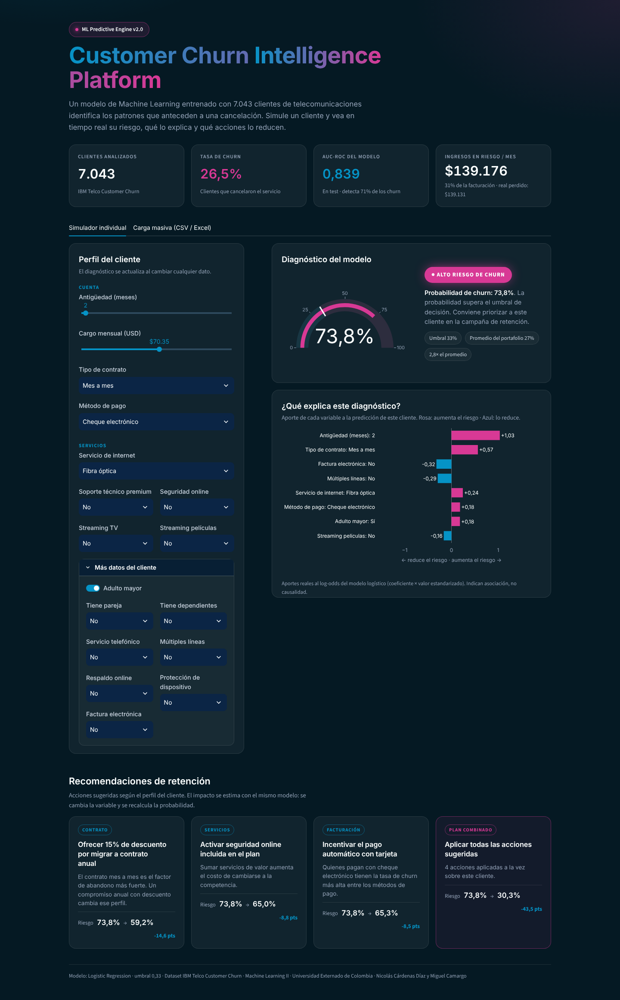
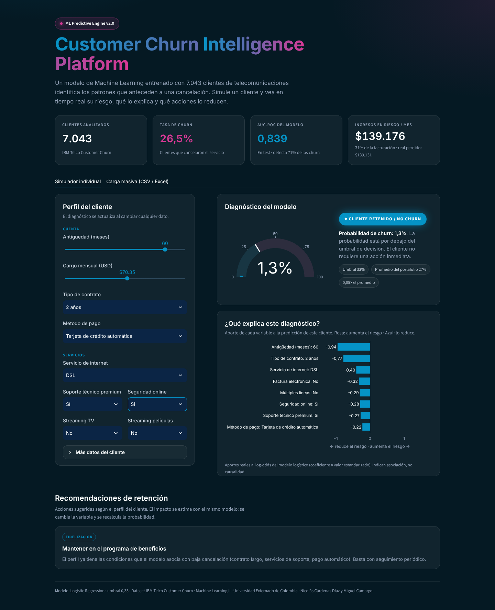
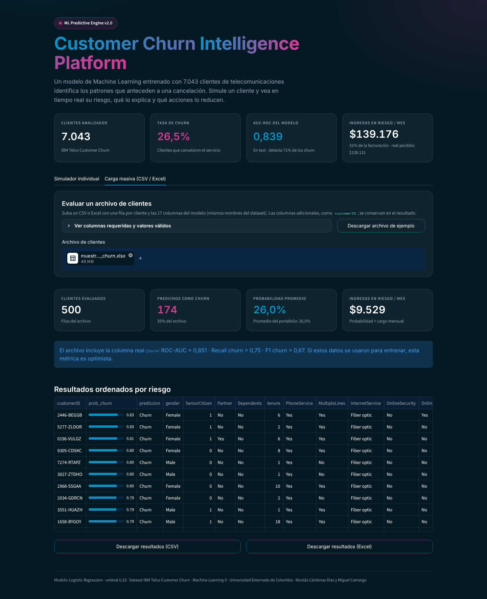

# Predicción de churn de clientes de telecomunicaciones

**Machine Learning II · 2026-2 · Universidad Externado de Colombia**
**Ruta A — Aprendizaje supervisado (clasificación binaria)**

**Autores:** Nicolás Cárdenas Díaz · Miguel Camargo

**Repositorio:** https://github.com/Gatitomalo1234/churn-streamlit-gcp



**Inicio rápido en una VM de Google Cloud** (Ubuntu 24.04, con el puerto 8501 abierto; ver sección 12):

```bash
curl -fsSL https://raw.githubusercontent.com/Gatitomalo1234/churn-streamlit-gcp/main/scripts/deploy_gcp.sh | bash
```

---

## 1. Objetivo

Estimar la probabilidad de que un cliente cancele su servicio (*churn*) a partir de su contrato, sus servicios contratados y su forma de pago. La salida permite priorizar acciones de retención sobre los clientes de mayor riesgo.

La solución cubre el ciclo completo: datos → `train.py` → `model.joblib` → app Streamlit → imagen Docker → VM en Google Cloud.

## 2. Dataset

- **Fuente:** IBM Telco Customer Churn (público), versionado en `data/telco_churn.csv`.
  - URL original: https://raw.githubusercontent.com/IBM/telco-customer-churn-on-icp4d/master/data/Telco-Customer-Churn.csv
  - Si el CSV no está, `train.py` lo descarga automáticamente.
- **Tamaño:** 7.043 filas, 21 columnas, sin duplicados.
- **Unidad de observación:** una fila representa un cliente.
- **Variable objetivo:** `Churn`, con valores Yes/No. El 26,5% de los clientes son churn.
- **Datos sensibles:** el dataset no contiene información personal identificable.

## 3. Variables utilizadas

| Tipo | Variables |
|---|---|
| Numéricas (3) | `tenure` (meses de antigüedad), `MonthlyCharges`, `SeniorCitizen` (0/1) |
| Categóricas (14) | `Partner`, `Dependents`, `PhoneService`, `MultipleLines`, `InternetService`, `OnlineSecurity`, `OnlineBackup`, `DeviceProtection`, `TechSupport`, `StreamingTV`, `StreamingMovies`, `Contract`, `PaperlessBilling`, `PaymentMethod` |

**Variables excluidas y por qué:**

- `customerID`: es un identificador y no tiene poder predictivo.
- `TotalCharges`:
  - Viene como texto, con 11 vacíos que corresponden a clientes con `tenure = 0`.
  - Su correlación con `tenure × MonthlyCharges` es 0,9996, así que es redundante.
  - Excluirla también evita pedir en la app un dato que se puede deducir.
- `gender`: la tasa de churn es casi igual en ambos géneros (26,9% y 26,2%), así que no aporta señal. Además, es un atributo sensible.

Todas las variables usadas son conocidas para un cliente activo en el momento de la predicción, por lo que no hay fuga de información.

## 4. Preparación de datos

Todo el preprocesamiento vive dentro de un `Pipeline` de scikit-learn, junto al modelo:

- **Numéricas:** imputación por mediana y luego `StandardScaler`.
- **Categóricas:** imputación por moda y luego `OneHotEncoder(handle_unknown="ignore")`.

Hay dos razones para hacerlo así:

- El escalador y el codificador se ajustan solo con los datos de entrenamiento de cada fold, lo que evita fuga en la validación cruzada.
- La app aplica exactamente las mismas transformaciones que se usaron en el entrenamiento.

## 5. Modelo y justificación

Se compararon tres modelos con validación cruzada estratificada de 5 folds, usando solo el 80% de entrenamiento. Ningún modelo usa `class_weight`, para que las probabilidades queden calibradas (ver más abajo). El desbalance se maneja con el umbral de decisión.

| Modelo | ROC-AUC CV (± std) | ROC-AUC train | Recall churn CV (umbral 0,5) |
|---|---|---|---|
| **Regresión logística** | **0,845 (± 0,012)** | 0,848 | **0,539** |
| Random Forest | 0,843 (± 0,008) | 0,924 | 0,499 |
| Hist Gradient Boosting | 0,842 (± 0,010) | 0,923 | 0,525 |

**Seleccionado: regresión logística.**

- **Mejor ROC-AUC y mejor recall en CV.** Las diferencias entre modelos son menores que la desviación entre folds, así que en la práctica rinden igual. En ese empate se prefiere el modelo más simple.
- **Sin sobreajuste.** Su brecha entre train y CV es de apenas 0,003. Los modelos de árboles alcanzan unos 0,92 en train sin ganar nada en CV, lo que indica que se sobreajustan sin beneficio.
- **Interpretable.** Sus coeficientes permiten explicar cada predicción dentro de la app.
- **Regla definida antes de ver los resultados:** se elige el mayor ROC-AUC en CV, salvo que la logística quede a 0,01 o menos del mejor, en cuyo caso se prefiere la logística.

**Umbral de decisión: 0,325.** Se eligió maximizando el F1 de la clase churn con predicciones *out-of-fold* del conjunto de entrenamiento, sin tocar el conjunto de prueba. Con el umbral por defecto de 0,5 el recall sería solo de 0,54; con 0,325 sube a 0,71.

**Probabilidades calibradas.** Una primera versión usaba `class_weight="balanced"`. El ROC-AUC era el mismo, pero las probabilidades salían infladas: en test, la probabilidad media predicha era 41,6% cuando la tasa real es 26,5% (Brier 0,169). Sin `class_weight`, la media predicha es 26,8% (Brier 0,139). Así, cuando la app dice "40% de riesgo", ese número se puede leer como una probabilidad real. Separar las dos tareas (probabilidades calibradas por el modelo y decisión por el umbral) es más limpio que reponderar las clases.

## 6. Evaluación

El 20% de prueba estratificado se usó **una sola vez**, con el modelo ya elegido.

| Métrica (test, umbral 0,325) | Valor |
|---|---|
| ROC-AUC | 0,839 |
| Recall churn | 0,714 |
| Precisión churn | 0,536 |
| F1 churn | 0,612 |
| Accuracy | 0,760 |
| F1 ponderado (ambas clases) | 0,770 |
| Brier score (menor es mejor) | 0,139 |
| Probabilidad media predicha vs. tasa real | 26,8% vs. 26,5% |

Matriz de confusión (filas: real; columnas: predicho):

|  | Pred. No churn | Pred. Churn |
|---|---|---|
| Real No churn | 804 | 231 |
| Real Churn | 107 | 267 |

**¿Por qué estas métricas y no solo accuracy?**

- Con un 26,5% de churn, un modelo que siempre responde "No" ya obtiene 73,5% de accuracy sin detectar a ningún cliente que se va.
- **ROC-AUC** mide la capacidad de ordenar a los clientes por riesgo, sin depender del umbral.
- **Recall de churn:** para retención es más costoso no detectar a un cliente que se va (falso negativo) que contactar a uno que se habría quedado (falso positivo). El modelo detecta el 71% de los clientes que cancelan.

**Variables más influyentes** (importancia por permutación en test, ver `reports/importancias.csv`):

1. `tenure`
2. `InternetService`
3. `Contract`
4. `MonthlyCharges`

Son asociaciones, no relaciones causales.

> Para el artefacto final, el modelo se reentrena con el 100% de los datos, usando la misma configuración y el mismo umbral. Las métricas reportadas corresponden al modelo entrenado solo con el conjunto de entrenamiento.

## 7. Interpretación de la salida de la app

La app (*Customer Churn Intelligence Platform*) usa un tema oscuro definido en `.streamlit/config.toml` y estilos propios inyectados con CSS. Arriba muestra cuatro indicadores del portafolio, calculados con el dataset y el modelo:

- Clientes analizados (7.043) y tasa de churn (26,5%).
- AUC-ROC en test (0,839).
- **Ingresos en riesgo por mes:** suma de probabilidad × cargo mensual de cada cliente. El modelo estima $139.176 y la facturación realmente perdida fue $139.131, lo que confirma que las probabilidades están calibradas.

Debajo hay dos pestañas.

**Simulador individual.** El diagnóstico se recalcula en vivo al cambiar cualquier dato del panel izquierdo (sliders para antigüedad y cargo mensual, `selectbox` para las categóricas; las variables secundarias están en "Más datos del cliente"). Si el cliente no tiene internet, los servicios que dependen de él se fijan en "Sin internet" para mantener la coherencia de los datos.

- **Gauge de riesgo:** probabilidad de churn de 0 a 100%, con una línea blanca en el umbral de decisión (0,325).
- **Diagnóstico:** *ALTO RIESGO DE CHURN* (rosa) si la probabilidad es mayor o igual al umbral; en caso contrario, *CLIENTE RETENIDO / NO CHURN* (azul).
- **¿Qué explica este diagnóstico?:** gráfico Plotly con las 8 variables de mayor aporte al log-odds (coeficiente × valor transformado). En una regresión logística esta descomposición es exacta, no una aproximación. Indica asociación, no causalidad.
- **Recomendaciones de retención:** reglas de negocio según el perfil (contrato, soporte, seguridad online, método de pago). El impacto de cada acción se estima con el mismo modelo: se cambia la variable y se recalcula la probabilidad. La tarjeta "Plan combinado" aplica todas las acciones a la vez.

**Carga masiva (CSV / Excel):** se sube un archivo con una fila por cliente y el modelo se ejecuta sobre todas las filas.

- **Columnas requeridas:** las 17 variables del modelo, con los mismos nombres del dataset. Las columnas adicionales, como `customerID`, se conservan en el resultado.
- **Validaciones:**
  - Si falta una columna, la app muestra un error claro.
  - Los valores no numéricos o vacíos se imputan con la mediana, con aviso.
  - Las categorías no vistas en entrenamiento se ignoran, con aviso.
  - `SeniorCitizen` acepta 0/1 o Yes/No.
- **Salida:**
  - Resumen: clientes evaluados, cuántos se predicen como churn y probabilidad promedio.
  - Tabla ordenada por riesgo, con `prob_churn` y `prediccion`.
  - Descarga de los resultados en CSV o Excel.
- **Si el archivo trae la columna real `Churn`,** la app muestra además ROC-AUC, recall y F1 sobre ese archivo.
- **Archivo de ejemplo:** `data/ejemplo_carga.csv` (20 clientes sin la columna `Churn`). También se puede descargar desde la app.

**Capturas de la app:**

| Alto riesgo | Cliente retenido | Carga masiva |
|---|---|---|
|  |  |  |

## 8. Estructura del proyecto

```
churn-streamlit-gcp/
├── app.py                 # Interfaz Streamlit (no reentrena)
├── train.py               # Entrenamiento reproducible -> model.joblib
├── model.joblib           # Artefacto: pipeline + metadatos
├── requirements.txt       # Dependencias con versiones fijadas
├── Dockerfile
├── .dockerignore
├── .gitignore
├── .streamlit/
│   └── config.toml        # Oculta el botón "Deploy" y la telemetría de Streamlit
├── README.md
├── data/
│   ├── telco_churn.csv       # Dataset de entrenamiento
│   ├── ejemplo_carga.csv     # Archivo de prueba para la carga masiva
│   └── pruebas/              # Archivos para verificar la app (ver sección 13)
├── reports/               # Generado por train.py
│   ├── cv_results.csv
│   ├── metrics.json
│   └── importancias.csv
├── notebooks/
│   └── 01_desarrollo_colab.ipynb   # Exploración y pruebas en Colab
├── scripts/
│   └── deploy_gcp.sh      # Despliegue automático en la VM (Docker + Git + contenedor)
└── docs/
    ├── capturas/          # Capturas de la app
    └── evidencias/        # Lista y capturas de evidencias del despliegue
```

> `requirements.txt` fija `scikit-learn==1.9.1` porque `model.joblib` debe cargarse con la misma versión con que se entrenó. Si cambia la versión, vuelva a ejecutar `python train.py`. `openpyxl` permite leer y exportar Excel en la carga masiva. `plotly` dibuja el gauge y el gráfico de factores.

## 9. Cómo ejecutar `train.py`

```bash
pip install -r requirements.txt
python train.py
```

Debe imprimir la comparación de modelos, el umbral y las métricas de test. Al final crea `model.joblib` y la carpeta `reports/`. Tarda unos 20 segundos.

## 10. Cómo ejecutar Streamlit

**Local:**

```bash
streamlit run app.py
# Abrir http://localhost:8501
```

**En Google Colab:**

1. Suba el zip del proyecto.
2. Abra `notebooks/01_desarrollo_colab.ipynb` y ejecute las celdas.
3. La sección 7 levanta la app con un túnel temporal (localtunnel).

## 11. Docker

**Construir la imagen** (desde la carpeta del proyecto):

```bash
docker build -t ml-streamlit-app .
```

**Prueba interactiva:**

```bash
docker run --rm -p 8501:8501 ml-streamlit-app
```

**En segundo plano:**

```bash
docker run -d --name ml-streamlit --restart unless-stopped -p 8501:8501 ml-streamlit-app
docker ps
docker logs ml-streamlit
```

El flujo es: `Dockerfile` → `docker build` → **imagen** → `docker run` → **contenedor** (la app en ejecución).

## 12. Despliegue en Google Cloud (Compute Engine)

1. **Crear la VM.** En Compute Engine, cree una instancia con Ubuntu 24.04 LTS, tamaño pequeño (por ejemplo e2-small) e IP externa. Agregue la etiqueta de red `streamlit-server`.
2. **Instalar Docker y Git.** Use el botón SSH de la consola:

   ```bash
   sudo apt update
   sudo apt install -y docker.io git
   sudo systemctl enable --now docker
   ```

3. **Clonar el repositorio y ejecutar:**

   ```bash
   git clone https://github.com/Gatitomalo1234/churn-streamlit-gcp.git
   cd churn-streamlit-gcp
   sudo docker build -t ml-streamlit-app .
   sudo docker run -d --name ml-streamlit --restart unless-stopped -p 8501:8501 ml-streamlit-app
   ```

4. **Abrir el puerto 8501 en el firewall:**

   ```bash
   gcloud compute firewall-rules create allow-streamlit-8501 \
     --allow=tcp:8501 --direction=INGRESS --target-tags=streamlit-server
   ```

   También puede crear la regla desde VPC network → Firewall.

5. **Abrir la app** en `http://IP_EXTERNA_DE_LA_VM:8501`.

**Alternativa automática.** Los pasos 2 y 3 se pueden reemplazar por un solo comando. El script instala Docker y Git si faltan, clona o actualiza el repositorio, construye la imagen, reemplaza el contenedor, verifica que la app responda e imprime la URL con la IP externa:

```bash
curl -fsSL https://raw.githubusercontent.com/Gatitomalo1234/churn-streamlit-gcp/main/scripts/deploy_gcp.sh | bash
```

Para actualizar tras un cambio en el repositorio, basta con ejecutar el mismo comando otra vez.

**Actualizar después de cambios:**

```bash
git pull
sudo docker stop ml-streamlit && sudo docker rm ml-streamlit
sudo docker build -t ml-streamlit-app .
sudo docker run -d --name ml-streamlit --restart unless-stopped -p 8501:8501 ml-streamlit-app
```

> Detenga o elimine la VM al terminar para evitar costos.

## 13. Ejemplo de entrada y salida

| Caso | Entrada principal | Salida esperada |
|---|---|---|
| Alto riesgo | Adulto mayor, `tenure`=2, cargo mensual 95, Month-to-month, Fiber optic, Electronic check, sin TechSupport ni OnlineSecurity (resto en su primera opción) | **≈ 79% → Churn (en riesgo)** |
| Bajo riesgo | No adulto mayor, `tenure`=60, cargo mensual 55, Two year, DSL, Credit card (automatic), con TechSupport y OnlineSecurity | **≈ 1% → No churn** |
| Valores por defecto | Medianas y primera categoría de cada lista | **≈ 26% → No churn** |
| Carga masiva | Subir `data/ejemplo_carga.csv` en la pestaña "Carga masiva" | **20 clientes evaluados, 13 marcados en riesgo**, tabla ordenada por riesgo y botones de descarga |

### Pruebas de verificación de la app

Los archivos de `data/pruebas/` permiten comprobar que la página ejecuta el modelo correctamente. Los valores esperados se verificaron en la app.

**1. Simulador (pestaña "Simulador individual").** Cada fila de `casos_formulario.csv` es un caso. Se ingresan sus valores en el panel izquierdo; los campos que no cambian quedan con su valor por defecto. "Adulto mayor" está en "Más datos del cliente".

| Caso | Cambios respecto al formulario por defecto | Esperado |
|---|---|---|
| Valores por defecto | Ninguno | 25,8% · No churn |
| Alto riesgo | Adulto mayor, antigüedad 2, cargo 95, Fiber optic, Electronic check | 78,5% · Churn |
| Cliente fiel | Antigüedad 60, cargo 55, Two year, Credit card, TechSupport y OnlineSecurity = Yes, Partner y Dependents = Yes | 0,9% · No churn |
| Frontera (20 meses) | Antigüedad 20 | 32,1% · No churn |
| Frontera (18 meses) | Antigüedad 18 | 33,6% · Churn |
| Alto riesgo con contrato de 2 años | Igual al alto riesgo, con Contract = Two year | 48,9% · Churn |

- Los casos de frontera prueban el umbral: bajar la antigüedad de 20 a 18 meses cruza 0,33 y cambia la clase.
- El último caso prueba la dirección del modelo: con todo igual, el contrato de dos años baja el riesgo de 78,5% a 48,9%.

**2. Consistencia entre pestañas.** Subir `casos_formulario.csv` en "Carga masiva" debe dar las mismas probabilidades que el formulario. Las columnas `esperado_prob` y `esperado_clase` se conservan en la tabla para compararlas.

**3. Clientes reales con respuesta conocida** (`clientes_reales_4.csv`):

| Cliente | Churn real | Probabilidad | Resultado |
|---|---|---|---|
| 9237-HQITU | Yes | 68,7% | Acierto |
| 7795-CFOCW | No | 4,4% | Acierto |
| 7590-VHVEG | No | 57,2% | Falso positivo |
| 3668-QPYBK | Yes | 28,3% | Falso negativo |

Muestra que el modelo también se equivoca, como indica su matriz de confusión.

**4. Desempeño sobre una muestra** (`muestra_500_con_churn.xlsx`): 500 clientes, 174 marcados en riesgo, ROC-AUC 0,851, recall 0,75 y F1 0,67. Es algo mejor que en test porque el modelo final se entrenó con todos los datos.

**5. Manejo de errores:**
- `error_falta_columna.csv`: debe mostrar "Faltan columnas requeridas: Contract".
- `valores_raros.csv`: debe procesar las 20 filas y mostrar dos avisos (un `tenure` no numérico y la categoría desconocida "Satellite").

## 14. Diagnóstico rápido

| Situación | Revisión |
|---|---|
| `train.py` falla | ¿Existe `data/telco_churn.csv` o hay internet? ¿Se instaló `requirements.txt`? |
| Error al cargar `model.joblib` | La versión de scikit-learn es distinta. Ejecute `python train.py` de nuevo. |
| El contenedor se detiene | `docker ps -a` y `docker logs ml-streamlit` |
| Funciona en la VM pero no desde afuera | Revise la regla de firewall, la etiqueta `streamlit-server` y la IP externa |

## 15. Prueba cruzada

Otra pareja reprodujo el proyecto usando solo este README. _(Completar tras la prueba.)_

- **Pareja evaluadora:** _[nombres]_
- **Fecha:** _[dd/mm/aaaa]_
- **¿Clonó el repositorio sin ayuda?** _[Sí / No]_
- **¿Construyó la imagen con `docker build`?** _[Sí / No — error encontrado]_
- **¿Ejecutó el contenedor y abrió la app?** _[Sí / No — en local o en VM]_
- **Caso probado y resultado obtenido:** _[por ejemplo, alto riesgo → 78,5% · Churn]_
- **Instrucciones faltantes o confusas:** _[...]_
- **Ajustes que hicimos al README después de la prueba:** _[...]_

## 16. Evidencias

Las capturas del despliegue (build, contenedor, firewall, app con IP externa y prueba cruzada) están en [`docs/evidencias/`](docs/evidencias/), con la lista de verificación de cada criterio de la rúbrica.
